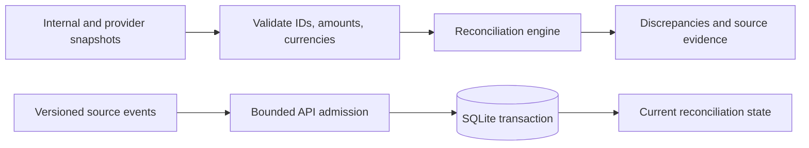

# Rust GPU Finance

**GPU-resident payment reconciliation in Rust, with a durable HTTP journal and
replay-verified recovery.** Built around exact integer amounts, versioned source
updates, explicit failure semantics and reproducible performance experiments.

The project explores how to build credible GPU-accelerated financial data systems.
It reconciles payment evidence; it does not execute or settle payments. The current
GPU API is an opt-in, single-GPU, single-tenant integration tested on an NVIDIA
RTX 5070 Laptop GPU on Windows. Its scope and remaining engineering work are documented.

## Start with the GPU system

- [Run the authenticated GPU API and restart demonstration](docs/GPU_API.md)
- [Architecture and acknowledgement/recovery guarantees](docs/GPU_ARCHITECTURE.md)
- [Resident GPU worker: one million payments and incremental update results](docs/performance/gpu-resident.md)
- [Fair CPU/GPU comparison](docs/performance/cpu-gpu-comparison.md) and [multicore baseline](docs/performance/multicore-comparison.md)
- [Live GPU crash/recovery acceptance test](tests/gpu_api_recovery.rs)
- [Rust compute library](perf/gpu/src/lib.rs), [GPU shader](perf/gpu/src/resident.wgsl), and [durable GPU actor](src/bin/api/gpu_service.rs)

The GPU remains resident between batches. The API acknowledges an update only after
its input and computed receipt commit to a SQLite WAL/FULL journal. On restart it
replays committed updates into GPU memory, checks the results and only then becomes
ready. There is no silent CPU fallback for GPU endpoints.

```powershell
# After setting a private RECONCILE_API_KEY: see docs/GPU_API.md
.\scripts\run-gpu-api.ps1

# Explicit hardware acceptance (requires a discrete GPU)
cargo test --locked --features gpu,client --test gpu_api_recovery -- --ignored --nocapture
```

The engineering record includes successful and unfavorable benchmark results.
Incremental GPU compute timings are kept separate from HTTP/durable-commit timings.
The project emphasizes measurable guarantees, documented tradeoffs and recoverable
systems over hardware marketing claims. See [architecture decisions and roadmap](docs/GPU_ARCHITECTURE.md).

## Existing reconciliation library and service

A Rust library, command-line tool, and HTTP service for comparing payment snapshots and continuously reconciling versioned source events. It reports all amount, status, and currency differences for each payment, with source evidence and investigation recommendations. It does not execute payments.

Version 0.4.0 is a locally tested pilot candidate, licensed under MIT. The Cargo package and command-line executable are named `reconcile-cli`. This public repository uses synthetic payment data; it is not a payment processor or a claim of production deployment.

Integration: [scoped credentials, retrying Rust client, discrepancy history, and checkout/provider demo](docs/INTEGRATION.md). Existing databases upgrade to schema 3; [back up before upgrading](docs/MIGRATION.md).

Durable operations: [outbox, automatic deadlines, signed webhooks, investigation queue, archival and recovery walkthrough](docs/DURABLE-OPERATIONS.md). Run `./examples/run-operations.ps1` for an isolated demonstration.

Operational setup: [tenant isolation, discrepancy search, metrics, backup/restore and sustained-load acceptance](docs/OPERATIONS.md).

[](https://github.com/ryanrose-fun/rust-reconciliation-engine/actions/workflows/ci.yml)

## Engineering highlights

- Exact minor-unit amounts and explicit currencies, with duplicate-ID validation.
- Library, CLI and HTTP interfaces sharing reconciliation behaviour.
- Versioned events persisted transactionally in SQLite, with idempotent retries and stale-update protection.
- Bounded admission, observable failures and request-level evidence.
- Unit, HTTP, schema and persistence tests; Windows/Linux CI and a container build.



Start with [src/lib.rs](src/lib.rs), [the library tests](tests/library.rs), [API contract](docs/API.md) and [benchmark methodology](docs/BENCHMARKS.md). Historical diagnostic artifacts are retained for traceability; local usernames in paths have been replaced with `local-user` for publication. They are local measurements, not production throughput promises.

## Run from source

Install Rust 1.99.1, then from the project folder:

```powershell
cargo fmt
cargo test --locked
cargo run --bin api
```

In another terminal:

```powershell
.\examples\test-api.ps1
.\examples\test-both-mismatches.ps1
.\examples\test-events.ps1
```

Default address: `http://127.0.0.1:3000`. Loopback-only development works without a token. Stop the server with Ctrl+C before rebuilding on Windows. Rust code changes require a restart; data file changes do not.

## Use the Windows release archive

Extract the complete archive into a folder and open PowerShell there:

```powershell
.\api.exe
```

In another terminal in that folder, run `./examples/test-api.ps1`. The archive contains example data, documentation, and checksums. For file reports:

```powershell
.\reconcile-cli.exe data/internal.json data/provider.json report.json
```

The equivalent source command is:

```powershell
cargo run -- data/internal.json data/provider.json report.json
```

## Authenticated service

Set a random token of at least 32 printable ASCII characters in the server terminal:

```powershell
$env:RECONCILE_API_KEY = Read-Host 'Paste a random token of at least 32 characters'
cargo run --bin api
```

Set the same environment variable in the client terminal; the example scripts then add `Authorization: Bearer ...`. Do not commit tokens. Non-loopback binding is refused without a token. Use HTTPS at a trusted reverse proxy for any remote access; see [deployment](docs/DEPLOYMENT.md).

## Current payment format

```json
{"id":"PAY-001","currency":"GBP","amount_minor":10000,"status":"Completed"}
```

Currency is mandatory. Supported values: GBP, USD, EUR (two decimal minor units) and JPY (zero). No currency conversion is performed. See [migration notes](docs/MIGRATION.md) before upgrading from `amount_pence`.

## Integration documents

- [API contract](docs/API.md): requests, responses, result names, and errors.
- [OpenAPI](docs/openapi.json): generated machine-readable schemas; also available at `GET /openapi.json`.
- [Deployment](docs/DEPLOYMENT.md): configuration, authentication, limits, TLS, containers, operations.
- [Traceability](docs/TRACEABILITY.md): report metadata and reproducibility limits.
- [Benchmarks](docs/BENCHMARKS.md): workloads, repeatable commands, and measured results.
- [Release checklist](docs/RELEASING.md): packaging and GitHub handoff.

## Code map

| File | Responsibility |
| --- | --- |
| `src/lib.rs` | `reconcile_report` public entry point |
| `src/payment.rs` | Types, supported currencies, ID validation |
| `src/reconciliation.rs` | Matching and combined findings |
| `src/recovery.rs` | Recommended investigations |
| `src/report.rs` | Report details and counts |
| `src/audit.rs` | IDs, timestamps, versions, input fingerprints |
| `src/main.rs`, `src/input.rs` | File-based command-line interface |
| `src/bin/api` | HTTP contract, configuration, authentication, limits |
| `src/bin/benchmark.rs` | Repeatable in-memory performance harness |

## Release and verification

```powershell
cargo test --locked
cargo clippy --locked --all-targets -- -D warnings
.\scripts\benchmark.ps1
.\scripts\package.ps1
```

CI is prepared for Windows/Linux tests, formatting, linting, release builds, dependency audit, and a Docker build. These hosted jobs require pushing the repository to GitHub; local checks do not prove hosted workflows or containers have run.

The default mode uses one shared token. Optional tenant mode provides separate databases and credentials; it is not a user-management or source-scoped authorization system. Reports are returned, not durably stored by the API. A pilot operator must retain source snapshots and reports under their own access and retention policies. This is not a banking certification or a production performance guarantee.
## Comparative performance and API load testing

See [the benchmark guide](perf/README.md) for reproducible engine comparisons and isolated, authenticated HTTP load tests. Results are saved under docs/performance.

Latest verified changes and measurements: [overload reliability and performance improvements](docs/performance/IMPROVEMENTS.md). Bank-facing release requirements are tracked in [engineering readiness](docs/ENGINEERING-READINESS.md).

## Financial ledger example

[Run the double-entry settlement journal](docs/LEDGER.md): exact minor-unit amounts, atomic SQLite postings, persistent idempotency, per-currency balancing, reversing entries and concurrent-write regression tests. Includes a clear discussion of enterprise deployment gaps.

## Continuous event processing

The [event walkthrough](docs/EVENTS.md) explains POST /v1/events, GET /v1/payments/{payment_id}, durable SQLite storage, duplicate protection, stale versions and the waiting deadline. Existing snapshot commands still work.
Persistent event performance: [run the load test](docs/EVENT-PERFORMANCE.md) and [read the local baseline](docs/performance/event-load-baseline.md).
Bounded event queue: [behaviour and timings](docs/EVENT-QUEUE.md), with [before/after measurements](docs/performance/event-queue-comparison.md).

Engineering trade-offs: [SQLite durability, bounded queues, idempotency and version ordering](docs/DECISIONS.md).

## Continuous checkout/provider integration

The [partitioned integration guide](docs/partitioned-integration.md) explains the simulated checkout/provider flow, signed alerts, group commits, fixed tenant partitions and routing contract. To run it when ready:

```powershell
.\examples\run-partitioned-integration.ps1 -Partitions 4
```
