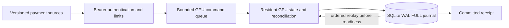

# GPU finance architecture: computation and durable acknowledgement

## Decision

Keep reconciliation state on a discrete GPU, and use a single-owner durable actor
to bridge HTTP, GPU computation and a recoverable journal. Rust owns validation,
resource lifetimes and admission. WGSL performs version checks, exact integer
comparisons and result-change compaction through wgpu.

## Why GPU computation precedes the durable receipt

The journal stores the exact input and computed receipt in one transaction. Applying
on the GPU first allows storage to record what was actually calculated, including
stale/conflict outcomes, rather than claiming success for an unexecuted intent.

This ordering creates an explicit failure boundary: if computation succeeds but the
commit fails, GPU memory can contain uncommitted changes. The implementation fails
closed: it terminates that worker, drops queued replies and serves no further GPU
state. Replay reconstructs the prior committed state on restart. Retrying stable
request IDs resolves a missing acknowledgement whether the commit succeeded or not.

| Failure point | Durable state | Recovery behavior |
|---|---|---|
| Before GPU execution | No new batch | Retry can apply it |
| After GPU execution, before commit | No acknowledged batch | Restart discards volatile changes; retry |
| After commit, before response | Committed input and receipt | Retry returns the stored receipt |
| Replay checksum/result mismatch | Journal inconsistent with contract | Refuse readiness |

The journal is the recovery authority; GPU memory is a rebuildable compute state.
SQLite FULL durability assumes the filesystem/storage device honors sync requests.
An acknowledged process restart is tested; power-loss hardware guarantees and disk
failure replication are separate engineering work.

## Concurrency and identity

One actor thread owns the GPU worker and SQLite connection. Its queue bounds pending
commands; HTTP limits bound request bytes and admission. GPU kernels remain massively
parallel within each batch. The owner is not a single-core reconciliation algorithm.

Host-assigned dense slots map exact string IDs. A patch contains at most one update
per source for a payment; one shader invocation owns that payment during a dispatch.
Amounts and versions retain all 64 bits through pairs of u32 values. No monetary
floating-point operations are used. Compact change rows are sorted by ID before
journaling so replay comparison is independent of GPU invocation completion order.

Request identity is durable and batch-scoped; event identity is durable and global
within this GPU journal. Source versions determine ordering. These are separate
concepts, with separate conflict checks.

## Evidence and next steps

This design is backed by executable forced-restart and commit-failure tests, not
just a graceful-shutdown demonstration. The repository retains the earlier fair
CPU/GPU comparisons, including results where GPU was slower, to make performance
claims auditable. The resident-worker results establish a useful incremental design;
they do not establish durable API throughput.

Next GPU work: measured durable API load and queue telemetry; replay checkpoints
with verified watermarks; source-scoped credentials and tenant-isolated GPU slots;
integration of waiting/history policies; device-loss supervision; multi-GPU routing
with explicit ownership and recovery. Each step needs correctness and latency
evidence before increasing deployment claims.
